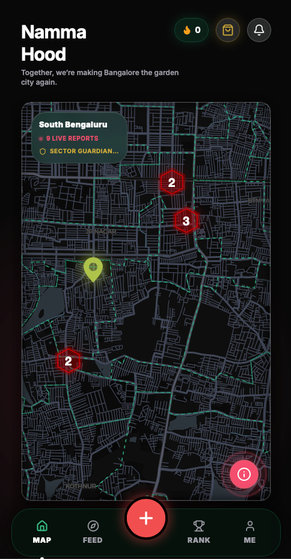
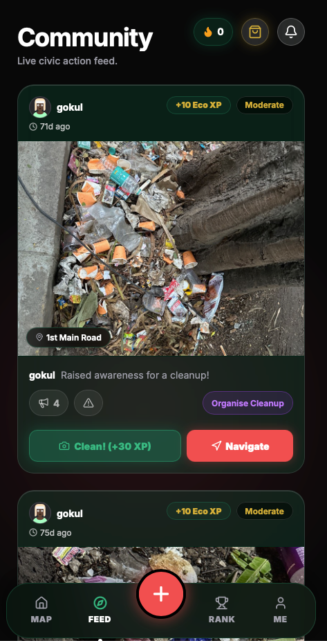
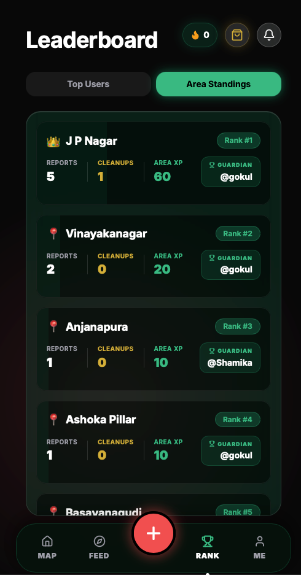
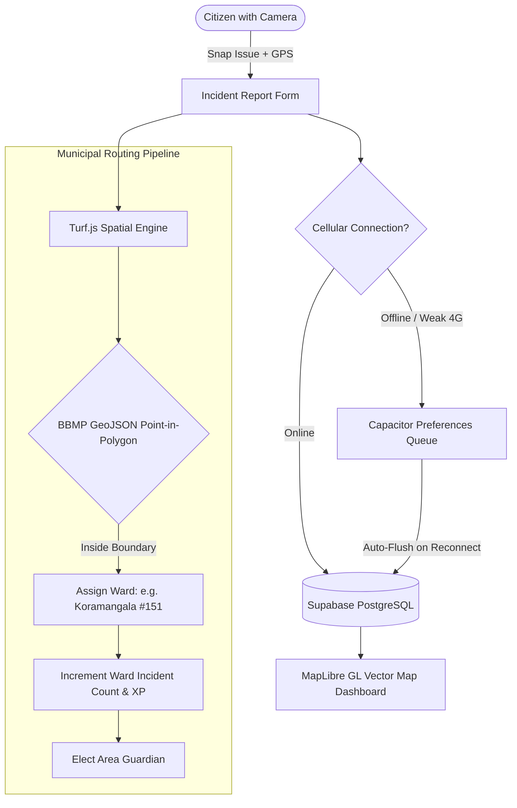

# Namma Hood

> Turning civic cleanup into a hyper-local territory movement across Bengaluru. Spot garbage blackspots, defend your ward, team up for SplitXP, and claim the title of Area Guardian.

<p align="center">
  
</p>

---

## The Big Idea

Municipal grievance portals are bureaucratic black holes: you file a ticket with a 14-digit reference number, wait three weeks, and watch the garbage pile continue to overflow. Venting on social media does not clean streets either.

**Namma Hood** reimagines civic maintenance as an action-driven neighborhood territory system:
- **Geo-Tagged Blackspot Spotting:** Snap a photo of an illegal dumping zone or civic hazard. Native GPS grabs pin-point coordinates with zero manual entry.
- **Real BBMP Ward Boundary Matching:** Turf.js runs mathematical point-in-polygon checks against official **Bruhat Bengaluru Mahanagara Palike (BBMP) ward vectors** (`bbmp.geojson`). Indiranagar, Koramangala, HSR Layout—every ward has its own real-time incident index and defense score.
- **The Area Guardian Title:** Neighborhoods track cleanup velocity. The citizen who leads verified cleanups in their ward holds the title of **Area Guardian** on the rolling 30-day leaderboard.
- **The SplitXP Incentive System:** Eliminates the bystander effect. If Citizen A spots an issue and Citizen B cleans it up with photo verification, **they split the XP: 60% to the cleaner and 40% back to the original spotter**. Spotting and resolving work hand-in-hand.
- **Direct Breakfast & Coffee Perks:** Earn Eco-Points through verified community drives that can be redeemed for breakfast discounts at local neighborhood eateries and partner cafes.

---

## Live Field Interface

### 1. Clustered Vector Blackspot Map
Live MapLibre GL spatial layer rendering municipal incident clusters across Bengaluru, displaying active sector counts, live reports, and BBMP ward boundaries.

<p align="center">
  
</p>

### 2. Community Civic Action Feed
Real-time incident stream where citizens discover nearby blackspots, organize community cleanups, or resolve issues with verified photo evidence to earn and split Eco-XP.

<p align="center">
  
</p>

### 3. Ward Standings & Area Guardian Leaderboard
Rolling 30-day municipal leaderboard tracking incident reports, verified cleanups, accumulated area XP, and reigning Area Guardian titles across Bengaluru wards.

<p align="center">
  
</p>

---

## Geospatial & Game Theory Mechanics



### 1. Point-in-Polygon Ward Assignment
Instead of asking users to select their municipal ward from a confusing dropdown of 198+ wards, Namma Hood uses `@turf/boolean-point-in-polygon` to automatically resolve GPS coordinates against official BBMP ward boundaries (`bbmp.geojson`) with sub-second spatial execution.

### 2. Clustered Vector Mapping
In dense metropolitan areas with hundreds of reports, rendering individual DOM markers tanks framerates. Namma Hood leverages **MapLibre GL** combined with **Supercluster** to dynamically group thousands of regional incidents into fluid, high-performance interactive clusters.

### 3. Built for Real Indian City Conditions
Field conditions in dense alleyways often have patchy cellular coverage. Reports filed with no signal are buffered into `@capacitor/preferences` on the device. An offline sync background worker listens for connectivity restoration and flushes queued uploads to Supabase automatically.

---

## Tech Stack

| Layer | Technology | Description |
| :--- | :--- | :--- |
| **Framework** | [Next.js 16](https://nextjs.org/) (React 19, App Router) | Fast hybrid SSR & static client bundle |
| **Styling & Motion** | [Tailwind CSS v4](https://tailwindcss.com/) & [Framer Motion](https://www.framer.com/motion/) | Responsive dark glassmorphic layout & spring interactions |
| **Mobile Runtime** | [Capacitor 8](https://capacitorjs.com/) | Native camera, GPS, haptics, and iOS Dynamic Island hooks |
| **Spatial Engine** | [Turf.js](https://turfjs.org/) | Point-in-polygon containment, buffers, and bounding boxes |
| **Vector Map** | [MapLibre GL](https://maplibre.org/) + [Supercluster](https://github.com/mapbox/supercluster) | WebGL vector map tiles & high-performance pin clustering |
| **Backend & DB** | [Supabase](https://supabase.com/) (PostgreSQL) | Realtime event channels, row-level security & storage |
| **Civic Data** | OpenStreetMap BBMP Extracts | Vector polygons of Bengaluru municipal ward zones |

---

## Project Structure

```text
littr/
├── src/
│   ├── app/                      # Next.js App Router
│   │   ├── page.tsx              # Interactive MapLibre GL map & incident feed
│   │   ├── report/page.tsx       # Camera capture, geolocation & severity grading
│   │   ├── leaderboard/page.tsx  # City-wide & ward guardian rankings
│   │   ├── profile/page.tsx      # User level, badges, civic streaks & statistics
│   │   └── shop/page.tsx         # Eco-Credits cosmetic store
│   ├── components/               # Modular UI components
│   │   ├── GarbageMap.tsx        # Clustered MapLibre GL layer with custom pins
│   │   ├── GarbageCard.tsx       # Incident report card with vote & resolve triggers
│   │   ├── DynamicIsland.tsx     # Native activity status pill
│   │   ├── ProgressionTree.tsx   # Visual skill milestones & achievements
│   │   ├── SplitXPModal.tsx      # Shared cleanup reward celebration
│   │   └── OfflineSyncWorker.tsx # Background queue manager for offline submissions
│   ├── lib/                      # Geospatial & business logic
│   │   ├── territories.ts        # BBMP ward point-in-polygon math & guardian logic
│   │   ├── missions.ts           # Dynamic daily quest generation
│   │   ├── economy.ts            # Eco-Credit reward algorithms
│   │   ├── streak.ts             # Consecutive civic activity tracking
│   │   ├── offlineSync.ts        # Local storage sync queue
│   │   └── supabase.ts           # Supabase client instantiation
│   └── data/
│       ├── reports.json          # Seed civic incident records
│       └── territories.json      # Ward index & boundary metadata
├── assets/                       # Branding & interface previews
│   ├── preview.png               # Squad onboarding & registration hub
│   ├── map_preview.png           # Clustered vector blackspot map
│   ├── feed_preview.png          # Community civic action & cleanup feed
│   ├── leaderboard_preview.png   # Ward standings & Area Guardian leaderboard
│   └── logo.png                  # App branding
├── bbmp.geojson                  # Official Bengaluru ward vector polygons
├── supabase_migrations.sql       # Database schema, triggers & realtime publications
├── capacitor.config.ts           # Mobile bridge configuration
├── android/                      # Native Android project
└── ios/                          # Native iOS project
```

---

## Getting Started

### 1. Prerequisites
- **Node.js** v20+ and **pnpm** (or npm)
- A free [Supabase](https://supabase.com) project

### 2. Clone & Install
```bash
git clone https://github.com/itsgoksz/namma-hood.git
cd namma-hood
pnpm install
```

### 3. Configure Environment Variables
Create `.env.local` in the project root:
```env
NEXT_PUBLIC_SUPABASE_URL=https://your-project.supabase.co
NEXT_PUBLIC_SUPABASE_ANON_KEY=your-supabase-anon-key
```

### 4. Database Setup
Run the SQL queries in `supabase_migrations.sql` in your Supabase SQL Editor to initialize:
- `users` and `reports` tables
- `increment_cleanups_count()` and `update_user_level()` trigger routines
- Realtime publication on `reports`

### 5. Launch the Web App
```bash
pnpm dev
```
Open [http://localhost:3000](http://localhost:3000) in your browser, or visit the live deployment at [nammavoice.nammauniverse.in](https://nammavoice.nammauniverse.in).

---

## Mobile Builds (iOS & Android)

```bash
# 1. Build the production static web bundle
pnpm build

# 2. Sync web assets with native mobile projects
npx cap sync

# 3. Launch in Xcode or Android Studio
npx cap open ios
npx cap open android
```

---

<p align="center">
  Built with pride for Bengaluru by <a href="https://github.com/itsgoksz">itsgoksz</a>
</p>
