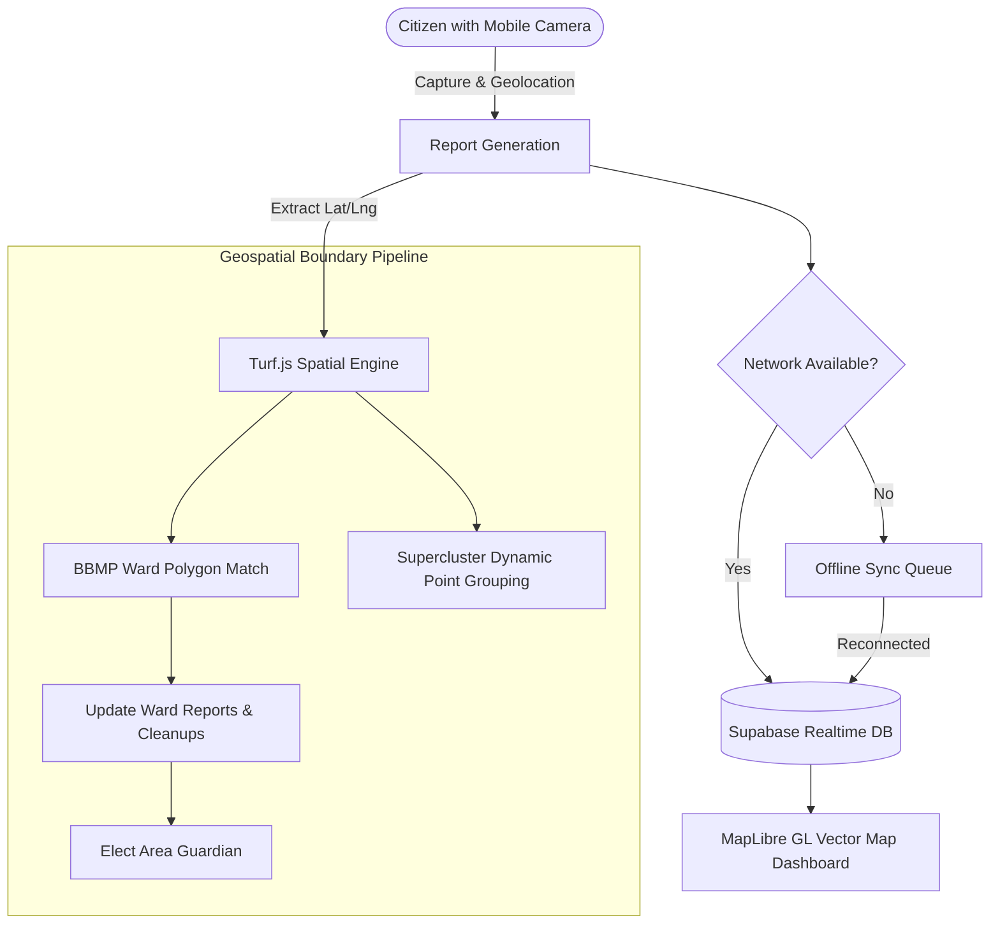

<p align="center">
  <h1 align="center">🏙️ Namma-Hood</h1>
  <p align="center">
    <strong>Gamified Civic Action & Real-Time Geospatial Neighborhood Cleanup Platform</strong>
  </p>
</p>

<p align="center">
  <a href="#overview">Overview</a> •
  <a href="#core-features">Features</a> •
  <a href="#geospatial-engine">Geospatial Engine</a> •
  <a href="#gamification--economy">Gamification & Economy</a> •
  <a href="#architecture">Architecture</a> •
  <a href="#tech-stack">Tech Stack</a> •
  <a href="#getting-started">Getting Started</a> •
  <a href="#mobile-builds">Mobile</a>
</p>

<p align="center">
  
  
  
  
  
  
  
</p>

---

## 📖 Overview

**Namma-Hood** is a hyper-localized civic empowerment platform that transforms public grievance reporting into an engaging, gamified community experience. Rooted in Bengaluru (*"Namma Ooru, Namma Hood"*), the platform empowers citizens to report civic disruptions—such as garbage blackspots, overflowing bins, and public hazards—with cryptographic GPS verification, real-time photographic proof, and territorial boundary mapping.

By merging **MapLibre GL** geospatial vector mapping with **Turf.js** spatial intelligence, Namma-Hood partitions metropolitan zones (e.g. Bruhat Bengaluru Mahanagara Palike / BBMP wards) into dynamic zones where citizens compete as **Area Guardians**, unlock **Progression Trees**, build **Civic Streaks**, and collaborate to verify cleanups.

---

## ✨ Core Features

- **📸 Instant Geo-Tagged Civic Reports**: In-browser or native camera capture with high-precision GPS coordinate anchoring, reverse geocoding, and severity grading (`Low`, `Medium`, `Severe`, `Critical`).
- **🗺️ Interactive Vector Map & Superclustering**: Real-time MapLibre GL 3D vector map featuring clustering with `supercluster` to render thousands of regional incidents with zero frame drop.
- **🛡️ Territory Capture & Area Guardians**: Neighborhood wards track cleanup velocity. Citizens who lead cleanup verifications claim and defend the title of **Area Guardian** for their ward.
- **⚡ SplitXP Cooperative Cleanups**: Solvers and original spotters share rewards when a resolution is verified by community voting.
- **🌱 Golden Seed & Progression Trees**: Unlockable skill trees and daily missions (Scout, Advocate, Cleaner) rewarding active community stewards.
- **🏪 Eco-Credits & Reward Economy**: Earn platform currency for valid reports to redeem unique profile auras, boosters, honorific titles, and custom themes.
- **📲 Offline-First Sync**: Powered by `@capacitor/preferences` and offline sync workers. File reports in low-connectivity areas; auto-sync when online.
- **📱 Native Mobile Integration**: Pre-configured Capacitor runtime with camera, haptics, geolocation, and iOS Dynamic Island / Live Activities support (`@capgo/capacitor-live-activities`).

---

## 📍 Geospatial & Territorial Engine

Namma-Hood relies on algorithmic spatial analysis to map civic responsibility across metropolitan boundaries:



### Territorial Analysis
- **Point-in-Polygon Computation**: Uses `@turf/boolean-point-in-polygon` against official ward GeoJSON boundaries (`bbmp.geojson`) to map each incident directly to its civic jurisdiction.
- **Density Convex Hulls**: Calculates neighborhood impact clusters using `@turf/convex` and `@turf/buffer`.

---

## 🎮 Gamification & Progression Mechanics

| System | Mechanics |
| :--- | :--- |
| **Area Guardian** | The highest XP contributor in a ward within a rolling 30-day window holds the territory badge. |
| **SplitXP System** | 60% of total resolution XP goes to the verified cleaner, 40% returns to the original spotter. |
| **Civic Streaks** | Daily consecutive reporting or verification maintains streak multipliers. |
| **Missions** | Rotational daily bounties (*Scout 2 spots*, *Verify 1 cleanup*, *Share ward leaderboard*). |
| **Eco Shop** | Spend earned Eco Credits on cosmetics like Golden Aura, Speed Boosters, and Ward Pioneer titles. |

---

## 💻 Tech Stack

| Layer | Technology | Description |
| :--- | :--- | :--- |
| **Framework** | [Next.js 15](https://nextjs.org/) (App Router) | Modern React framework with hybrid SSR & PWA output |
| **Language** | [TypeScript](https://www.typescriptlang.org/) | Strict end-to-end typed contracts |
| **Geospatial & Maps** | [MapLibre GL](https://maplibre.org/) · [Turf.js](https://turfjs.org/) | WebGL vector maps, spatial topologies, and point clustering |
| **Database & Realtime**| [Supabase](https://supabase.com/) | PostgreSQL, Realtime subscriptions, and Storage |
| **Mobile Runtime** | [Capacitor 8](https://capacitorjs.com/) | Native camera, GPS, haptics, and iOS Live Activities |
| **UI & Styling** | [Tailwind CSS](https://tailwindcss.com/) · [Framer Motion](https://www.framer.com/motion/) | Responsive glassmorphic layout & fluid gesture micro-interactions |
| **Icons & VFX** | [Lucide React](https://lucide.dev/) · [Canvas Confetti](https://www.npmjs.com/package/canvas-confetti) | Visual status badges and celebratory animations |

---

## 📂 Project Structure

```text
littr/
├── src/
│   ├── app/                      # Next.js App Router pages
│   │   ├── page.tsx              # Primary interactive map & live feed
│   │   ├── report/page.tsx       # Geotagged camera reporting flow
│   │   ├── leaderboard/page.tsx  # City-wide & ward guardian rankings
│   │   ├── profile/page.tsx      # User level, badges, and streaks
│   │   └── shop/page.tsx         # Eco-Credits store
│   ├── components/               # Modular UI components
│   │   ├── GarbageMap.tsx        # MapLibre GL map with custom pin layers
│   │   ├── GarbageCard.tsx       # Incident verification & action card
│   │   ├── DynamicIsland.tsx     # Floating native activity status bar
│   │   ├── ProgressionTree.tsx   # Visual skill and reward milestones
│   │   └── SplitXPModal.tsx      # Shared cleanup reward celebration
│   └── lib/                      # Core business & geospatial logic
│       ├── territories.ts        # Ward boundary & guardian calculations
│       ├── missions.ts           # Dynamic daily mission generation
│       ├── economy.ts            # Eco-Credits calculation & shop rules
│       ├── offlineSync.ts        # Queue management for offline reports
│       ├── streak.ts             # Daily activity tracking
│       └── supabase.ts           # Supabase client & real-time listeners
├── android/                      # Native Android project (Capacitor)
├── ios/                          # Native iOS project (Capacitor)
├── bbmp.geojson                  # Bengaluru municipal ward boundary data
├── supabase_migrations.sql       # Database schema & trigger definitions
├── capacitor.config.ts           # Mobile bridge configuration
└── README.md                     # Project documentation
```

---

## 🚀 Getting Started

### Prerequisites
- **Node.js**: v18.18 or higher
- **pnpm** or **npm**
- A [Supabase](https://supabase.com) account

### 1. Clone & Install
```bash
git clone https://github.com/itsgoksz/namma-voice.git
cd namma-voice
pnpm install
```

### 2. Configure Environment Variables
Create `.env.local` in the project root:
```env
NEXT_PUBLIC_SUPABASE_URL=https://your-project.supabase.co
NEXT_PUBLIC_SUPABASE_ANON_KEY=your-supabase-anon-key
```

### 3. Initialize Database
Execute the queries in `supabase_migrations.sql` in your Supabase SQL editor to create the `reports`, `votes`, and `profiles` tables.

### 4. Run Development Server
```bash
pnpm dev
```
Open **`http://localhost:3000`** in your browser to view the live interface.

---

## 📱 Mobile Builds (iOS & Android)

```bash
# Build static web assets
pnpm build

# Sync with native Capacitor platforms
npx cap sync

# Launch in Xcode (macOS)
npx cap open ios

# Launch in Android Studio
npx cap open android
```

---

## 📄 License

Distributed under the **MIT License**.

<p align="center">
  Built for a cleaner Bengaluru by <a href="https://github.com/itsgoksz">itsgoksz</a>
</p>
