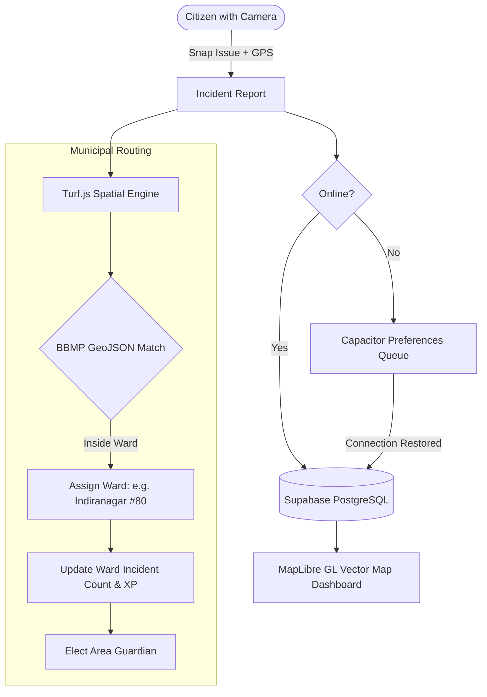

# 🏙️ Namma-Hood

> **Turning civic cleanup into a hyper-local territory war across Bengaluru.** Spot garbage, defend your ward, team up for SplitXP, and become an Area Guardian.

<p align="center">
  
</p>

---

## The Big Idea

Bengaluru has a civic dilemma we all know: black spots and overflowing street corners that linger for weeks. Filing complaints on slow municipal portals or venting on social media rarely mobilizes people on the ground. 

**Namma-Hood** takes inspiration from territory-control games and turns civic maintenance into a cooperative, high-stakes community game:
- **Spot & Geo-tag:** Snap a photo of a civic issue. Native GPS extracts high-precision coordinates.
- **BBMP Ward Boundary Matching:** Turf.js runs point-in-polygon math against real Bruhat Bengaluru Mahanagara Palike (BBMP) ward boundaries (`bbmp.geojson`) to assign the issue to its exact municipal ward.
- **Territory War & Area Guardians:** Every ward has a live leaderboard. Citizens who verify and lead cleanups in Koramangala, Indiranagar, or HSR Layout defend the title of **Area Guardian**.
- **SplitXP System:** No zero-sum reporting. When a spot gets resolved and verified by the community, **60% XP goes to the cleaner** and **40% returns to the original spotter**.
- **Missions & Eco Shop:** Complete daily quests (*Scout 2 spots*, *Verify a cleanup*, *Maintain a 5-day streak*), earn Eco-Credits, and unlock profile flairs, titles, and custom auras.

---

## 🕹️ Core Game Mechanics

### 1. Geo-Tagged Reporting Flow
Capture issues in seconds through native mobile cameras (via Capacitor Camera) or web upload. Each report anchors:
- Latitude / Longitude with reverse geocoding
- Severity rating (`Low`, `Medium`, `Severe`, `Critical`)
- Photos stored and synced to Supabase Storage

### 2. Ward Boundaries & Area Guardians
Using `@turf/boolean-point-in-polygon` against official ward vectors, each report automatically increments the ward's incident tracker. Active community contributors earn XP through reporting, upvoting, and verified cleanup submissions. The top contributor in each ward holds the **Area Guardian** crown.



### 3. SplitXP Collaborative Cleanups
Traditional reporting apps only reward the person who fixes the issue or only the person who files it. Namma-Hood splits the reward:
- **Spotter (40% XP):** Rewarded for discovering the issue with clean geo-data.
- **Cleaner (60% XP):** Rewarded for executing the cleanup and uploading verification proof.
- **Community Consensus:** Upvotes and verifications release the final XP allocation atomically.

### 4. Offline-First Field Sync
Field conditions in dense neighborhoods often have patchy cellular reception. Reports made offline are buffered into `@capacitor/preferences` storage. An offline sync worker detects connectivity changes and flushes queued reports to Supabase automatically when back online.

---

## 🛠️ Tech Stack

- **Frontend & App Framework:** [Next.js 16](https://nextjs.org/) (React 19, App Router)
- **Styling & Motion:** [Tailwind CSS v4](https://tailwindcss.com/) with fluid glassmorphism and [Framer Motion](https://www.framer.com/motion/)
- **Mobile Runtime:** [Capacitor 8](https://capacitorjs.com/) (`@capacitor/camera`, `@capacitor/geolocation`, `@capacitor/haptics`, `@capacitor/preferences`, `@capgo/capacitor-live-activities`)
- **Geospatial & Vector Mapping:** [MapLibre GL](https://maplibre.org/) + [Supercluster](https://github.com/mapbox/supercluster) for clustered pin rendering + [Turf.js](https://turfjs.org/) for geospatial polygon containment
- **Backend & Database:** [Supabase](https://supabase.com/) (PostgreSQL, Realtime Broadcast/Subscriptions, Row Level Security)
- **Civic Data:** BBMP Ward boundaries compiled from OpenStreetMap (`bbmp.geojson`)

---

## 📂 Project Structure

```text
littr/
├── src/
│   ├── app/                      # Next.js App Router
│   │   ├── page.tsx              # Interactive MapLibre GL map & incident feed
│   │   ├── report/page.tsx       # Camera capture, geolocation & severity form
│   │   ├── leaderboard/page.tsx  # City-wide and ward guardian rankings
│   │   ├── profile/page.tsx      # User level, badges, streak tracking & stats
│   │   └── shop/page.tsx         # Eco-Credits cosmetic shop
│   ├── components/               # UI components
│   │   ├── GarbageMap.tsx        # Clustered MapLibre GL layer with custom pins
│   │   ├── GarbageCard.tsx       # Incident report card with vote & resolve triggers
│   │   ├── DynamicIsland.tsx     # Native activity & quick status pill
│   │   ├── ProgressionTree.tsx   # Visual skill milestones & achievements
│   │   ├── SplitXPModal.tsx      # Split reward celebration modal
│   │   └── OfflineSyncWorker.tsx # Background queue processor for offline submissions
│   ├── lib/                      # Geospatial & app logic
│   │   ├── territories.ts        # BBMP ward point-in-polygon math & guardian logic
│   │   ├── missions.ts           # Dynamic daily quest generation
│   │   ├── economy.ts            # Eco-Credit reward algorithms
│   │   ├── streak.ts             # Consecutive civic activity tracking
│   │   ├── offlineSync.ts        # Local storage sync queue
│   │   └── supabase.ts           # Supabase client instantiation
│   └── data/
│       ├── reports.json          # Seed & fallback civic incident records
│       └── territories.json      # Ward index & boundary metadata
├── bbmp.geojson                  # Official Bengaluru ward vector polygons
├── supabase_migrations.sql       # Database schema, triggers & realtime publications
├── capacitor.config.ts           # Mobile bridge configuration
├── android/                      # Native Android project
└── ios/                          # Native iOS project
```

---

## 🚀 Getting Started

### 1. Prerequisites
- **Node.js** v20+ and **pnpm** (or npm)
- A free [Supabase](https://supabase.com) project

### 2. Clone & Install
```bash
git clone https://github.com/itsgoksz/namma-hood.git
cd namma-hood
pnpm install
```

### 3. Configure Environment Variables
Create `.env.local` in the project root:
```env
NEXT_PUBLIC_SUPABASE_URL=https://your-project.supabase.co
NEXT_PUBLIC_SUPABASE_ANON_KEY=your-supabase-anon-key
```
*(Optional: add `NEXT_PUBLIC_GOOGLE_MAPS_API_KEY` or `NEXT_PUBLIC_MAPTILER_API_KEY` for custom satellite tile providers).*

### 4. Database Setup
Run the SQL queries in `supabase_migrations.sql` in your Supabase SQL Editor. This sets up:
- `users` and `reports` tables
- `increment_cleanups_count()` and `update_user_level()` triggers
- Supabase Realtime publication on `reports`

### 5. Launch the Web App
```bash
pnpm dev
```
Open [http://localhost:3000](http://localhost:3000) in your browser.

---

## 📱 Mobile Deployment (iOS & Android)

Namma-Hood is packaged natively with Capacitor:

```bash
# 1. Build the production static web bundle
pnpm build

# 2. Sync web assets with native mobile projects
npx cap sync

# 3. Launch in Xcode or Android Studio
npx cap open ios
npx cap open android
```

---

<p align="center">
  Built with ❤️ for Bengaluru by <a href="https://github.com/itsgoksz">itsgoksz</a>
</p>
